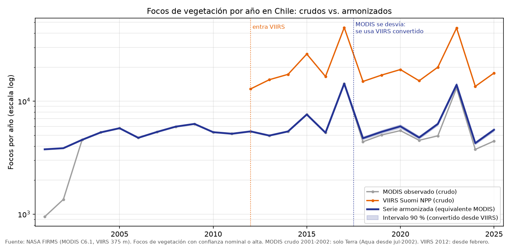

# Armonización MODIS ↔ VIIRS
_Generado por `scripts/05_armonizar.py` el 2026-11-21 16:28 UTC. No editar a mano: se regenera._

## Resumen
- **Serie:** 345 comunas × 302 meses (2000-11 a 2025-12), en **focos equivalentes MODIS**: lo que habrían contado Terra + Aqua con su órbita nominal y su procesamiento previo a 2018.
- **Método elegido:** Factor único. Razón VIIRS/MODIS = **3.18** (calibrada 2012-03 a 2017-12).
- **Validación fuera de muestra (2016-2017):** sesgo -2.6 %, error región-mes 15.8 %, error nacional-mes 8.5 %, correlación nacional 0.999, cobertura del intervalo del 90 % 93 %.
- **Hallazgo:** los métodos más complejos (por región, por mes, modelos de conteo) no mejoran fuera de muestra: las diferencias por región y temporada que se ven al calibrar no se repiten de un año a otro. Lo decisivo es calibrar en el período en que MODIS todavía es estable.

| Período | Serie armonizada | Por qué |
|---|---|---|
| 2000-11 a 2002-06 | Terra convertido a Terra + Aqua (Factor por mes) | Aqua todavía no existía |
| 2002-07 a 2017-12 | MODIS observado (Terra + Aqua) | Referencia estable |
| 2018-01 en adelante | VIIRS Suomi NPP convertido a escala MODIS | MODIS cambia de procesamiento en 2018 y su órbita se desvía; VIIRS es estable |

## 1. VIIRS → MODIS: comparación de métodos
Calibración 2012-03 a 2015-12, prueba 2016-01 a 2017-12 (incluye los megaincendios de 2017). Errores relativos ponderados (suma de errores absolutos / suma observada). Regla de elección: menor error región-mes; con diferencias menores a 0.5 puntos, el método más simple.

| Método | Sesgo total | Error comuna-mes | Error región-mes | Error nacional-mes | Correlación nacional | Cobertura 90 % |
|---|---|---|---|---|---|---|
| Factor único | -0.026 | 0.344 | 0.158 | 0.085 | 0.999 | 0.926 |
| Factor por temporada | -0.046 | 0.352 | 0.167 | 0.078 | 0.999 | 0.927 |
| Factor por mes | -0.047 | 0.362 | 0.182 | 0.097 | 0.999 | 0.927 |
| Factor por zona | -0.016 | 0.356 | 0.190 | 0.097 | 0.999 | 0.925 |
| Factor por región | -0.044 | 0.366 | 0.197 | 0.086 | 0.999 | 0.925 |
| Proporcional Poisson (C(zona) + C(temporada)) | -0.059 | 0.388 | 0.195 | 0.095 | 0.999 | 0.948 |
| Proporcional Poisson (C(cod_region) + C(mes)) | -0.071 | 0.405 | 0.214 | 0.103 | 0.999 | 0.948 |
| Binomial negativa con pendiente (región + mes) | 0.823 | 1.155 | 0.976 | 0.866 | 0.994 | 0.963 |

## 2. Terra → Terra + Aqua (meses antes de Aqua)
Calibración 2003-2008, prueba 2009-2011.

| Método | Sesgo total | Error comuna-mes | Error región-mes | Error nacional-mes | Correlación nacional | Cobertura 90 % |
|---|---|---|---|---|---|---|
| Factor único | -0.012 | 0.827 | 0.461 | 0.330 | 0.833 | 0.871 |
| Factor por temporada | -0.030 | 0.801 | 0.414 | 0.261 | 0.881 | 0.871 |
| Factor por mes | -0.056 | 0.772 | 0.388 | 0.207 | 0.928 | 0.870 |
| Factor por zona | -0.014 | 0.825 | 0.460 | 0.334 | 0.830 | 0.871 |
| Factor por región | -0.019 | 0.819 | 0.441 | 0.321 | 0.847 | 0.870 |
| Proporcional Poisson (C(zona) + C(temporada)) | -0.065 | 0.888 | 0.508 | 0.275 | 0.878 | 0.947 |
| Proporcional Poisson (C(cod_region) + C(mes)) | -0.092 | 0.859 | 0.437 | 0.228 | 0.932 | 0.947 |
| Binomial negativa con pendiente (región + mes) | 0.932 | 1.685 | 1.211 | 1.025 | 0.865 | 0.958 |

## 3. Deriva de MODIS: cuánto cuenta respecto de lo esperado según VIIRS (%)
Negativo = MODIS detecta menos de lo que debería. Cerca de 0 en 2012-2017 (período de calibración); desde 2018 refleja el cambio de procesamiento y la deriva de órbita (ver [calidad_datos.md](calidad_datos.md)).

| año | MODIS (Terra + Aqua) | Terra | Aqua |
|---|---|---|---|
| 2012 | 7.3 | -28.4 | 23.6 |
| 2013 | 1.8 | -23.5 | 13.4 |
| 2014 | -0.6 | 2.2 | -1.9 |
| 2015 | -7.2 | -12.3 | -4.9 |
| 2016 | 1.1 | 0.4 | 1.4 |
| 2017 | 1.6 | 21.5 | -7.6 |
| 2018 | -7.0 | -34.7 | 5.7 |
| 2019 | -6.2 | -15.4 | -1.9 |
| 2020 | -8.3 | -0.6 | -11.9 |
| 2021 | -5.4 | -8.5 | -4.0 |
| 2022 | -21.5 | -15.4 | -24.3 |
| 2023 | -6.5 | 22.3 | -19.6 |
| 2024 | -12.0 | -21.4 | -7.6 |
| 2025 | -20.5 | -40.1 | -11.6 |

## 4. Continuidad de VIIRS: NOAA-20 frente a Suomi NPP
Factor NOAA-20 / Suomi NPP calibrado 2019-01 a 2025-12: **0.970**. Guardado en `data/processed/calibracion.json` para cuando Suomi NPP deje de entregar datos. No se usa en la serie actual (Suomi NPP cubre hasta 2025) y nunca se suman ambos satélites.

| año | NOAA-20 / Suomi NPP |
|---|---|
| 2018 | 0.935 |
| 2019 | 0.995 |
| 2020 | 0.973 |
| 2021 | 1.016 |
| 2022 | 0.953 |
| 2023 | 0.933 |
| 2024 | 1.019 |
| 2025 | 0.980 |

## 5. Límites
- La conversión supone que la relación VIIRS/MODIS de 2012-2017 se mantiene. VIIRS es estable en ese período y después; la validación cubre dos años, uno de ellos extremo (2017).
- Los meses de 2000-11 a 2002-06 (solo Terra) son los menos precisos: error nacional-mes 21 % en la prueba, contra 8.5 % de la conversión desde VIIRS. Sus intervalos son más anchos.
- A escala de una comuna y un mes el error es alto (ver la tabla); para decidir conviene mirar agregados (región, temporada, año) y el intervalo `armonizado_p05`-`armonizado_p95`.
- Desde 2018 la serie es un valor esperado (más suave) y antes es un conteo observado: los percentiles que mezclan ambos períodos deben leerse con cuidado.
- Se cuentan **detecciones** de vegetación con confianza nominal o alta (`uso_base`), no incendios ni superficie quemada.
