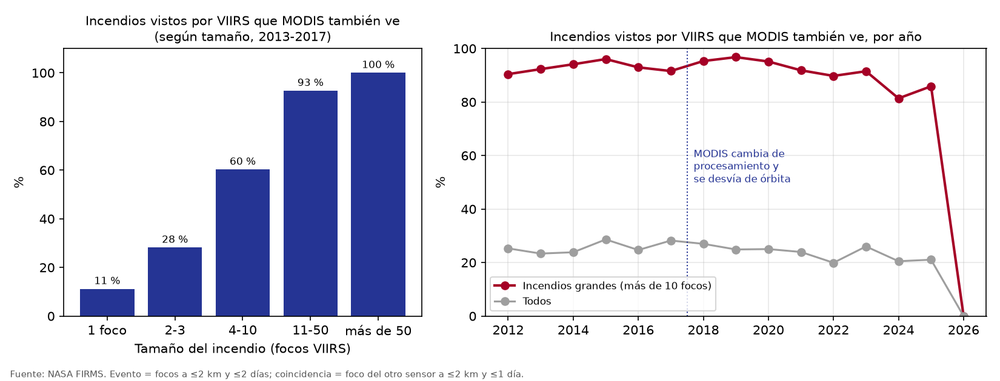

# Focos vs. incendios: ¿por qué VIIRS ve más que MODIS?
_Generado por `scripts/06_eventos.py` el 2026-11-21 16:33 UTC. No editar a mano: se regenera._

## Resumen
- **Hipótesis:** VIIRS (375 m) parte un mismo incendio en más píxeles que MODIS (1 km); contando incendios en vez de focos, la diferencia debería acercarse a 1.
- **Resultado: se cumple solo en parte.** En 2013-2017 la razón Suomi NPP / MODIS baja de **3.2** (focos) a **2.3** (incendios), y con cualquier definición razonable de incendio queda entre 1.8 y 2.3, nunca cerca de 1.
- **La mayor parte de la diferencia es sensibilidad:** 54 % de los incendios que ve VIIRS son de un solo foco, y MODIS ve solo el **11 %** de ellos; de los incendios de más de 50 focos ve el **100 %**.
- **La deriva de MODIS también se ve en incendios grandes:** en 2012-2020 MODIS veía en promedio el **94 %** de los incendios grandes que veía VIIRS; en 2024-2025, el **84 %**.
- **Consecuencia para el producto:** agrupar en incendios no armoniza los sensores; por eso la serie usa calibración ([armonizacion.md](armonizacion.md)). La serie en equivalente MODIS sub-representa los incendios chicos, que solo VIIRS ve bien.

## 1. Razón entre sensores contando focos y contando incendios
Incendio (evento) = focos del mismo sensor a ≤2 km y ≤2 días, encadenados. MODIS = Terra + Aqua juntos. 2012 sin enero para VIIRS.

| año | Focos SNPP/MODIS | Eventos SNPP/MODIS | Focos por evento MODIS | Focos por evento SNPP |
|---|---|---|---|---|
| 2012 | 2.47 | 2.22 | 2.26 | 2.51 |
| 2013 | 3.13 | 2.56 | 1.97 | 2.41 |
| 2014 | 3.20 | 2.33 | 2.53 | 3.48 |
| 2015 | 3.43 | 2.24 | 2.79 | 4.28 |
| 2016 | 3.15 | 2.27 | 2.23 | 3.10 |
| 2017 | 3.13 | 1.94 | 5.86 | 9.48 |
| 2018 | 3.42 | 2.55 | 2.16 | 2.90 |
| 2019 | 3.39 | 2.68 | 2.79 | 3.53 |
| 2020 | 3.47 | 2.58 | 2.76 | 3.72 |
| 2021 | 3.37 | 2.65 | 2.40 | 3.05 |
| 2022 | 4.06 | 3.05 | 3.11 | 4.14 |
| 2023 | 3.40 | 2.51 | 6.85 | 9.31 |
| 2024 | 3.62 | 2.63 | 2.35 | 3.22 |
| 2025 | 4.01 | 2.77 | 2.75 | 3.98 |

## 2. Sensibilidad de la razón de incendios (2013-2017)

| Distancia (km) | 1 día(s) | 2 día(s) | 4 día(s) |
|---|---|---|---|
| 1 | 1.76 | 1.79 | 1.80 |
| 2 | 2.22 | 2.27 | 2.27 |
| 4 | 2.16 | 2.20 | 2.18 |
| 8 | 2.00 | 2.02 | 1.96 |

## 3. ¿Qué incendios vistos por VIIRS ve también MODIS? (2013-2017)
Coincidencia: algún foco MODIS a ≤2 km y ≤1 día de algún foco del incendio.

| Tamaño (focos VIIRS) | Incendios | % del total | MODIS también lo ve (%) | FRP total mediana (MW) |
|---|---|---|---|---|
| 1 foco | 14 940 | 54.1 | 11.2 | 3.4 |
| 2-3 | 8 008 | 29.0 | 28.2 | 11.5 |
| 4-10 | 3 597 | 13.0 | 60.2 | 46.8 |
| 11-50 | 924 | 3.3 | 92.6 | 241.5 |
| más de 50 | 157 | 0.6 | 100.0 | 1 914.1 |

Por año:

| año | Todos | Incendios grandes (más de 10 focos) |
|---|---|---|
| 2012 | 25.3 | 90.4 |
| 2013 | 23.4 | 92.3 |
| 2014 | 23.9 | 94.1 |
| 2015 | 28.6 | 96.1 |
| 2016 | 24.7 | 93.0 |
| 2017 | 28.2 | 91.6 |
| 2018 | 27.0 | 95.3 |
| 2019 | 24.9 | 96.8 |
| 2020 | 25.0 | 95.1 |
| 2021 | 24.0 | 91.9 |
| 2022 | 19.9 | 89.8 |
| 2023 | 26.0 | 91.5 |
| 2024 | 20.5 | 81.4 |
| 2025 | 21.1 | 85.9 |
| 2026 | 0.0 | 0.0 |

Al revés, VIIRS ve el **60 %** de los incendios que ve MODIS (2013-2017): cada sensor ve incendios que el otro no, en parte porque pasan a horas distintas (Terra en la mañana; Aqua y Suomi NPP después del mediodía). NOAA-20 ve el **46 %** de los incendios de Suomi NPP (2019-2025), coherente con que ambos VIIRS ven casi lo mismo.

## 4. Caso Viña del Mar, febrero de 2024 (comuna 05109)

| Sensor | Incendios que tocan Viña | Focos dentro de Viña | Focos del mayor incendio (todas las comunas) | Comunas que abarca el mayor |
|---|---|---|---|---|
| MODIS | 3 | 16 | 64 | 3 |
| SNPP | 2 | 102 | 354 | 3 |
| NOAA20 | 1 | 126 | 426 | 3 |

## 5. Límites
- La definición de incendio es una aproximación (vecindario cuadrado y encadenamiento); dos incendios vecinos y simultáneos se cuentan como uno.
- La coincidencia depende de la geolocalización: los píxeles MODIS del borde del barrido miden hasta ~3 km, así que a 2 km algunas coincidencias reales quedan fuera.
- Se usan focos de vegetación con confianza nominal o alta (`uso_base`).
