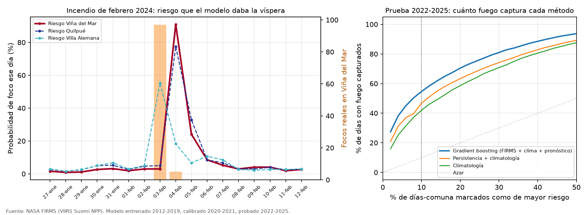

# Riesgo de focos por comuna a 24 h, 48 h y 7 días
_Generado por `scripts/08_riesgo.py` el 2026-11-21 18:21 UTC. No editar a mano: se regenera._

## Resumen
- **Pregunta:** ¿habrá al menos un foco VIIRS (Suomi NPP) en la comuna mañana? Unidad: comuna × día (1 863 345 filas). Tasa base en prueba: 3.3 %.
- **Bloques de variables usados:** FIRMS, clima, pronostico. Modelo elegido: **Gradient boosting (FIRMS + clima + pronóstico)** (`hgb_firms_clima_pronostico_v4`), por precisión media en el período de calibración.
- **Prueba 2022-2025 (nunca vista al entrenar):** AUC **0.858**, precisión media **0.313** (la tasa base es 0.033), el 10 % de días-comuna de mayor riesgo captura el **55 %** de los días con fuego (lift ×5.5).
- **Supera a las líneas base** (climatología AUC 0.793, persistencia 0.815). La regresión logística rinde casi igual (AUC 0.835): la ganancia viene de las variables, no de la complejidad del modelo. Se usa gradient boosting porque admite nuevos bloques (clima, vegetación) sin rediseñar.
- **Clima de los días que predice (v4):** el modelo usa la temperatura máxima, la humedad mínima, el viento máximo y la lluvia de mañana (y de pasado mañana a 48 h). En esta prueba son las **observadas** (NASA POWER): es una cota superior. Al publicar se usa el pronóstico de Open-Meteo, que además rellena los ~4 días de rezago de NASA POWER; con pronósticos reales archivados (2024-2025, 80 comunas con más fuego) la precisión media a 24 h fue 0.32 (antes, con el clima de hace 4 días, 0.25). Detalle: [pronostico_validacion.md](pronostico_validacion.md).
- **Prueba nueva 2026** (2026-01-02 a 2026-11-01, datos que no existían al elegir el modelo): AUC **0.888** (climatología 0.821), precisión media 0.385.
- **Horizontes:** en precisión media, el modelo supera a la climatología de su horizonte ×2.08 a 24 h, ×1.58 a 48 h y ×1.09 a 7 días: la vista semanal es sobre todo estacional (orientativa).
- **Límite honesto:** sus alertas (nivel alto o muy alto) **sirven para priorizar, no para anticipar todo**. En comunas **con fuego reciente** acertaron el **33 %** de las veces (tasa base 17 %) y cubrieron el 84 % de los días con fuego. En comunas **sin fuego reciente** acertaron el **14 %** (6 veces la tasa base de 2.2 %), pero el **77 %** de los incendios nuevos empezó sin alerta. La mayoría de las igniciones son humanas.
- **Caso Viña del Mar:** la víspera del 3 de febrero de 2024, con el fuego todavía en comunas vecinas, el modelo subió el riesgo de Viña de 1.9 % a **3.0 %** (nivel `bajo`), pero no lo marcó como alto. Ni siquiera con el clima de ese día (calor, baja humedad y viento) anticipa el salto de un incendio a otra comuna: el clima eleva el riesgo de toda la zona, no dice hacia dónde avanza el fuego.

## 1. Comparación de modelos (24 h)
Entrenamiento 2012-02 a 2019-12; calibración de probabilidades (isotónica) 2020-2021; prueba 2022-2025. La climatología es la frecuencia histórica de la comuna en ese mes; la persistencia ordena primero las comunas con fuego hoy (no es probabilidad: sin Brier).

| Modelo (prueba 2022-2025, 24 h) | AUC | Precisión media | Captura top 10 % | Lift top 10 % | Brier | Tasa base |
|---|---|---|---|---|---|---|
| Climatología (comuna × mes) | 0.793 | 0.151 | 0.420 | 4.196 | 0.031 | 0.033 |
| Persistencia + climatología | 0.815 | 0.207 | 0.468 | 4.682 | — | 0.033 |
| Regresión logística (FIRMS) | 0.835 | 0.266 | 0.511 | 5.113 | 0.028 | 0.033 |
| Gradient boosting (FIRMS) | 0.834 | 0.265 | 0.507 | 5.069 | 0.028 | 0.033 |
| Gradient boosting (FIRMS + clima) | 0.847 | 0.283 | 0.529 | 5.290 | 0.028 | 0.033 |
| Gradient boosting (FIRMS + clima + pronóstico) | 0.858 | 0.313 | 0.546 | 5.464 | 0.027 | 0.033 |

## 2. Ignición vs. propagación (prueba 2022-2025)

|  | AUC | Precisión media | Captura top 10 % | Tasa base |
|---|---|---|---|---|
| Gradient boosting (FIRMS + clima + pronóstico) / ignición | 0.815 | 0.111 | 0.421 | 0.022 |
| Gradient boosting (FIRMS + clima + pronóstico) / propagación | 0.837 | 0.569 | 0.398 | 0.166 |
| Climatología / ignición | 0.758 | 0.071 | 0.336 | 0.022 |
| Climatología / propagación | 0.707 | 0.327 | 0.240 | 0.166 |
| Persistencia + climatología / ignición | 0.758 | 0.071 | 0.336 | 0.022 |
| Persistencia + climatología / propagación | 0.745 | 0.375 | 0.290 | 0.166 |

Alertas del modelo elegido (nivel alto o muy alto, probabilidad ≥ 12 %):

| Segmento | Días-comuna | Alertas (alto o muy alto) | % de alertas con fuego | % del fuego que tuvo alerta | Tasa base (%) |
|---|---|---|---|---|---|
| propagación | 40 181 | 17 054 | 32.6 | 83.5 | 16.6 |
| ignición | 463 864 | 16 768 | 14.2 | 23.4 | 2.2 |

## 3. Horizontes de 48 h y 7 días
Mismas variables que a 24 h. Cada modelo se compara con la climatología de su propio horizonte (frecuencia histórica, en la comuna y el mes, de tener al menos un foco en esos días). La precisión media sube con el horizonte solo porque hay más casos positivos: lo que importa es cuánto supera a la climatología.

|  | AUC | Precisión media | Captura top 10 % | Lift top 10 % | Brier | Tasa base |
|---|---|---|---|---|---|---|
| Gradient boosting 48 h | 0.842 | 0.353 | 0.478 | 4.785 | 0.045 | 0.058 |
| Climatología 48 h | 0.789 | 0.223 | 0.388 | 3.881 | 0.050 | 0.058 |
| Gradient boosting 7 días | 0.813 | 0.470 | 0.345 | 3.455 | 0.104 | 0.152 |
| Climatología 7 días | 0.790 | 0.430 | 0.322 | 3.216 | 0.110 | 0.152 |

Ventaja sobre la climatología en precisión media: 24 h ×2.08, 48 h ×1.58, 7 días ×1.09. **A 7 días el modelo aporta poco sobre el calendario:** usa el clima observado del último día, que dice poco de la semana siguiente. La vista semanal debe rotularse como orientativa (estacional); para mejorarla haría falta un pronóstico del tiempo.

Umbrales de nivel por horizonte. A 48 h y 7 días se fijan para que, en calibración 2020-2021, cada nivel agrupe la misma proporción de días-comuna que a 24 h (con los umbrales de 24 h, a 7 días casi todo saldría "alto").

| Horizonte | muy alto desde (%) | alto desde (%) | medio desde (%) |
|---|---|---|---|
| 24 h | 30.0 | 12.0 | 4.0 |
| 48 h | 43.1 | 20.8 | 8.2 |
| 7 días | 74.9 | 48.7 | 24.6 |

## 3b. Prueba nueva: 2026
Días que no existían cuando se construyó y eligió el modelo (bajados con la MAP_KEY de FIRMS). Objetivo y variables de Suomi NPP; no se usaron para ajustar nada.

|  | AUC | Precisión media | Captura top 10 % | Tasa base |
|---|---|---|---|---|
| Modelo | 0.888 | 0.385 | 0.626 | 0.034 |
| Climatología | 0.821 | 0.178 | 0.487 | — |

Período 2026-01-02 a 2026-11-01 (104.880 días-comuna, 3.524 con fuego). Nivel muy alto: acertó el 51.1 % de las veces. Alto o muy alto: 6.1 % de los días-comuna con el 53.3 % del fuego.

Suomi NPP tiene datos hasta el 2026-11-01; del 2026-11-02 al 2026-11-14 el modelo usa NOAA-20 en su lugar (mismo instrumento VIIRS; en 2022-2025, con variables de NOAA-20 el modelo rinde igual: AUC 0,845 vs 0,846).

El clima está al día con los focos.

## 4. Calibración (prueba 2022-2025)
Si la probabilidad está bien calibrada, lo predicho y lo observado coinciden en cada decil.

|  | predicho | observado | n |
|---|---|---|---|
| decil 1 | 0.000 | 0.001 | 50 405 |
| decil 2 | 0.001 | 0.001 | 50 404 |
| decil 3 | 0.003 | 0.003 | 50 405 |
| decil 4 | 0.007 | 0.006 | 50 404 |
| decil 5 | 0.011 | 0.011 | 50 405 |
| decil 6 | 0.016 | 0.017 | 50 404 |
| decil 7 | 0.024 | 0.025 | 50 404 |
| decil 8 | 0.036 | 0.037 | 50 405 |
| decil 9 | 0.059 | 0.052 | 50 404 |
| decil 10 | 0.211 | 0.182 | 50 405 |

## 5. Qué variables pesan
Caída de la precisión media al desordenar cada variable (muestra de la prueba).

| Variable | Caída de precisión media |
|---|---|
| frp_hoy | 0.0577 |
| hrmin_f1 | 0.0525 |
| dias_desde_ultimo | 0.0431 |
| lat | 0.0392 |
| clim_comuna_mes | 0.0303 |
| n_7d | 0.0291 |
| n_30d | 0.0254 |
| mes | 0.0236 |
| clim_comuna | 0.0212 |
| lon | 0.0179 |
| tmax | 0.0148 |
| precip_f1 | 0.0127 |
| tmax_f1 | 0.0114 |
| precip | 0.0082 |
| precip_7d | 0.0056 |
| viento_f1 | 0.0041 |
| hrmin | 0.0038 |
| viento_max | 0.0006 |

## 6. Caso Viña del Mar, febrero de 2024

| Día | Riesgo predicho la víspera (%) | Nivel | Focos reales |
|---|---|---|---|
| 2024-01-27 | 1.6 | bajo | 0.0 |
| 2024-01-28 | 0.9 | bajo | 0.0 |
| 2024-01-29 | 1.1 | bajo | 0.0 |
| 2024-01-30 | 2.6 | bajo | 0.0 |
| 2024-01-31 | 3.2 | bajo | 0.0 |
| 2024-02-01 | 1.9 | bajo | 0.0 |
| 2024-02-02 | 3.0 | bajo | 0.0 |
| 2024-02-03 | 3.0 | bajo | 97.0 |
| 2024-02-04 | 91.0 | muy_alto | 5.0 |
| 2024-02-05 | 24.1 | alto | 0.0 |
| 2024-02-06 | 8.5 | medio | 0.0 |
| 2024-02-07 | 5.2 | medio | 0.0 |
| 2024-02-08 | 3.0 | bajo | 0.0 |
| 2024-02-09 | 4.1 | medio | 0.0 |
| 2024-02-10 | 4.1 | medio | 0.0 |
| 2024-02-11 | 1.9 | bajo | 0.0 |
| 2024-02-12 | 2.6 | bajo | 0.0 |

## 7. Niveles y salidas
- Niveles por probabilidad a 24 h: `bajo` < 4 % (≈ tasa base) ≤ `medio` < 12 % ≤ `alto` < 30 % ≤ `muy_alto`. A 48 h y 7 días, los umbrales de la sección 3.
- `percentil`: posición de la probabilidad contra las del mismo comuna y mes en 2020-2025.
- `data/processed/riesgo.parquet`: riesgo desde el día siguiente al último dato (2026-11-14) a 24 h, 48 h y 7 días, con el contrato `riesgo`. Para un riesgo de verdad para mañana hacen falta los focos de 2026 (FIRMS casi en tiempo real, MAP_KEY).
- `data/processed/riesgo_backtest.parquet`: predicciones de 2020-2025 con lo que pasó, para revisar casos.
- Para sumar variables (clima, vegetación) basta crear el bloque con llave comuna × día: el script lo detecta y agrega la fila a la comparación.
